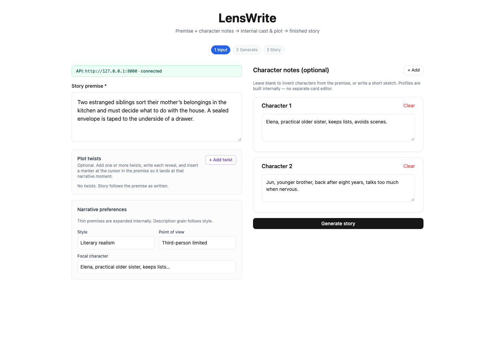
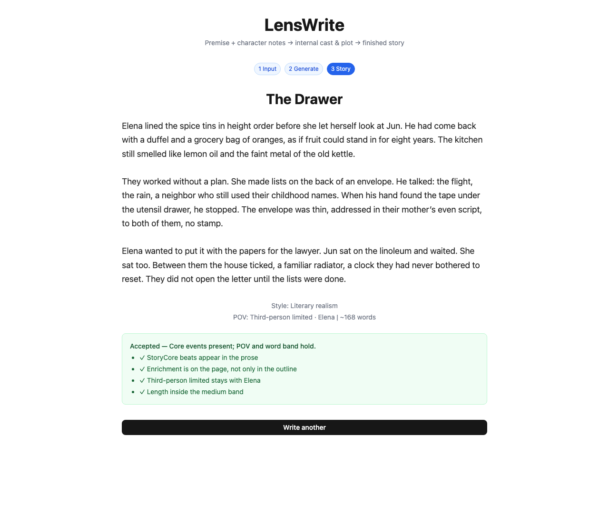
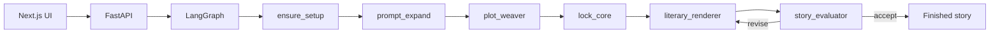

# LensWrite

Multi-agent literary short-story generator. Type a premise; get a finished draft.

The UI never exposes intermediate “character cards.” Cast, plot core, prose, and revision all run inside a LangGraph pipeline on the API.



## What it does

You provide:

- a story premise (required)
- optional character sketches
- optional plot-twist lines, placed in the premise with `⟦TWIST:n⟧` markers
- style, point of view, and length

The API then:

1. **Setup** — invents or enriches the cast from the seed
2. **Outline** — expands a thin premise into a structured outline
3. **Plot weaver** — builds a frozen StoryCore (beats, scenes, no literary style)
4. **Renderer** — writes scene-by-scene prose (dual draft, then length expand/trim)
5. **Evaluator** — critic loop: fidelity, enrichment-in-prose, POV/style, word band  
   Failed checks re-render until the story is accepted or the iteration cap is hit



## Pipeline



LLM calls go to **xAI Grok**. The browser never sees the API key.

## Stack

| Layer | Tech |
|-------|------|
| UI | Next.js 16, React 19, Tailwind |
| API | FastAPI, LangGraph, LangChain |
| Model | xAI (`XAI_API_KEY`) |
| Deploy | Vercel (UI) + Railway / Render (API) |

```
lenswrite-backend/    FastAPI + LangGraph
lenswrite-frontend/   Next.js UI
```

## Quick start

```bash
cp lenswrite-backend/.env.example lenswrite-backend/.env
# set XAI_API_KEY in lenswrite-backend/.env

cp lenswrite-frontend/.env.example lenswrite-frontend/.env.local

python3 -m venv .venv
source .venv/bin/activate
pip install -r lenswrite-backend/requirements.txt

cd lenswrite-frontend && npm install && cd ..

./start-backend.sh    # http://127.0.0.1:8000/docs
./start-frontend.sh   # http://localhost:3000
```

## API

| Method | Path | Role |
|--------|------|------|
| `POST` | `/stories` | Start generation from premise + optional drafts / twists |
| `GET` | `/stories/{thread_id}/status` | Poll until the draft is ready |
| `GET` | `/health` | Liveness; reports whether `XAI_API_KEY` is set |

Generation is asynchronous. The UI polls `/status` (typically 1–3 minutes).

## Deploy

Split deploy: API on Railway or Render, UI on Vercel. Step-by-step in [DEPLOY.md](./DEPLOY.md).

Keys live only in host environment variables. See [SECURITY.md](./SECURITY.md).

## Highlights

- LangGraph state machine with a frozen plot core and a critic revise loop
- Scene-segmented literary renderer with acceptance checks
- Next.js client that talks to FastAPI over CORS, with health diagnostics and status polling
- Split Vercel / Railway deploy; LLM keys stay on the server
